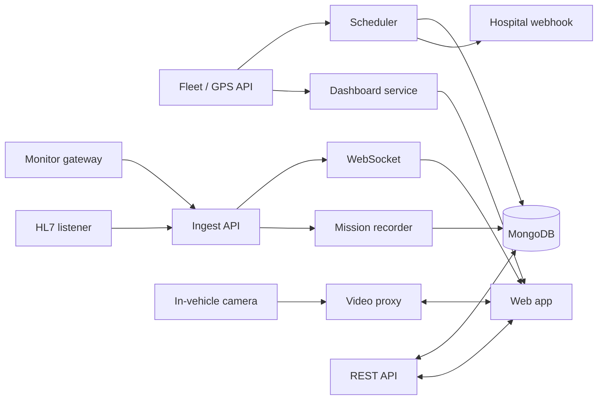
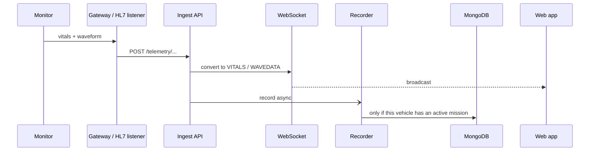
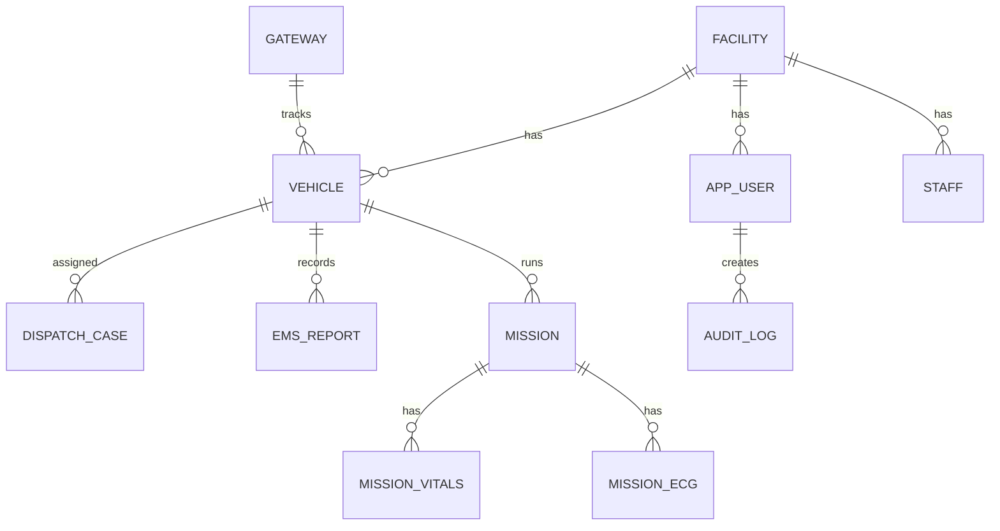

[ไทย](README.md) | [English](README.en.md)

# Connected Ambulance Platform

A real-time ambulance tracking system. Dispatch centers and receiving hospitals see the vehicle's location, in-vehicle camera and the patient's vital signs on one screen while the patient is on the way.

This repo is a design write-up for my portfolio. It contains no production source code. Collection names, endpoints and sample data have been renamed or made up, and none of it is real customer data.

Stack: Angular, Node.js (Express), MongoDB, WebSocket, node-cron, Nginx, WebRTC/RTSP, HL7 v2

## Role: Systems Analyst

- Gathered requirements from medical staff, dispatch centers and other stakeholders
- Designed the system architecture, data flow, sequences and workflows
- Wrote the specs for the REST API, WebSocket payloads, webhook security and HL7 data mapping
- Designed the database (MongoDB collections and indexes) and data access control (RBAC, audit log)
- Wrote the documentation and set up the security structure needed for ISO/IEC 27001 certification
- Coordinated and tested with the dev team and receiving organizations (SIT / UAT)


## Background

Before this system, every piece of data lived somewhere else. Vehicle location and cameras were on the GPS box vendor's fleet platform, vital signs stayed on the monitor inside the ambulance, and case records were on paper. Doctors at the receiving hospital had no idea of the patient's condition until the ambulance arrived.

The goal was to bring all of it together, with access control so each organization only sees its own vehicles and cases, since this is patient data.

What the system does today:

- Map of all vehicles, with status, GPS, speed and alarms refreshed from the fleet platform on a schedule
- Monitor page showing live HR, SpO2, BP, RR and ECG waveforms from the device in the vehicle
- In-vehicle camera view and teleconsult rooms between the hospital and the vehicle
- Dispatch form and EMS operation form
- Start/end an operation (mission); while it runs, vitals and ECG are recorded for playback later
- Dashboard with distance, alarms and overtime parking for a selected date range
- Overspeed alerts and a daily summary pushed to each hospital's system via webhook
- Some features can be turned on or off per hospital, which we used to pilot features at one site first


## System overview

Data comes in three ways:

1. Vehicle data: a cron job in the backend pulls from the fleet platform API and writes to the DB
2. Vital signs: the gateway attached to the monitor POSTs data to us, and the backend pushes it to the web app over WebSocket
3. Video: goes through a reverse proxy to the vendor's video server



### Vehicle data (pull)

The cron job runs at the interval set in config. Each run logs in to the fleet platform, fetches the vehicle list with online status, coordinates and speed, and upserts it into the `vehicle` collection. Devices not yet linked to a vehicle in our system go to an "unsynced" list for an admin to match by hand.

The same run checks speed. Over 90 km/h is YELLOW, over 120 is RED. Alerts are grouped per hospital and sent to that hospital's webhook. We don't wait for the response (5 second timeout) so a slow receiver can't hold up the sync.

Another job runs every hour. It builds yesterday's summary (distance, driving time, number of overspeed events), sends it by webhook and keeps a copy for 7 days in case it needs to be resent.

Every webhook carries `x-timestamp` and `x-signature` (HMAC-SHA256 of timestamp + body) so the receiver can verify it came from us.

### Vital signs (push)



The gateway sends a `monitor_id` with the data. The backend uses it to find the vehicle, maps the value names to one common format, and broadcasts over WebSocket right away.

Some monitor models send HL7 v2 (ORU^R01). A separate listener receives it over MLLP, turns the OBX segments into JSON and posts to the same API. MSH-3 identifies the device.

### Mission (operation recording)

Staff can start an operation from several pages (monitor, map, or when accepting a case). A unique partial index on `vehicle` + `status: active` stops a vehicle from having two open missions.

While a mission is active, data going through ingest is also saved:

- Vitals: at most one point every 5 seconds per vehicle, with a NEWS score
- ECG: chunks of about 1 second, all leads

After the mission ends it can be replayed on the Dashboard: vitals for the whole case, and ECG one window at a time (max 60 seconds per request).


## Database



| Collection | Key fields | Notes |
| --- | --- | --- |
| facility | facility_code, name, lat, lng, webhook_url, webhook_enabled, dashboard_enabled, mission_enabled | Center of access rights and feature flags |
| vehicle | display_name, device_id, monitor_id, hl7_source_id, online, speed_kph, position, alarms, gateway_id | monitor_id / hl7_source_id link a monitor to a vehicle |
| gateway | name, api_base_url, session_token | Source fleet platform |
| app_user | username, password_hash, role, facility_code, must_change_password | Passwords set by an admin must be changed before use |
| staff | staff_code, name, facility_code | |
| dispatch_case | case_no, vehicle_id, location, symptoms, triage_level, timeline, crew, patients | Dispatch form |
| ems_report | operation_no, officers, timeline, patient, treatment | EMS operation form |
| mission | vehicle, status, start, end, case_id, patient snapshot | One active per vehicle |
| mission_vitals | mission_id, t, hr, pr, spo2, rr, sys, dia, map, news | |
| mission_ecg | mission_id, t, leads, n, data (binary) | Deleted after 24 hours |
| consult_session | room_id, caller, participants, start, end | |
| audit_log | user, action, resource, ip, status, timestamp | TTL 90 days |
| daily_summary_outbox | facility_id, summary_date, vehicles | TTL 7 days |

Live vitals are not all saved. They are stored only while the vehicle has an open mission.


## Lessons learned

**Don't let DB writes block live data**
Ingest sends to WebSocket first. Mission recording is a separate promise that isn't awaited. If the write fails it just gets logged. The monitor page should never freeze because the DB is slow.

**Plan ECG storage size from day one**
The first version stored a single ECG lead as an array of numbers. Once we needed all leads so playback matched the live monitor, we switched to packing every lead for that time window into one Buffer (Int16LE, one lead after another) instead of one document per lead. A cron job deletes anything older than 24 hours every midnight. The reader still handles the old format until that data expires.

**Per-IP rate limiting doesn't work for hospitals**
We first limited per IP. But the map page polls every 2-5 seconds, video also goes through the backend, and many machines in one hospital share a single NAT IP. The whole hospital got blocked. We switched to counting per user id from the JWT (falling back to IP without a token). Device push endpoints aren't counted at all: one monitor sends around 150 requests a minute and all of them come through the same gateway IP.

Login has its own limit, 5 attempts per 15 minutes, keyed on IP + username, so one person mistyping a password doesn't lock out others on the same IP.

**A dev server with a copy of the production DB must not send webhooks**
Otherwise hospitals get duplicate alerts from the dev machine. A `WEBHOOKS_ENABLED` env var turns them off. There's also a relay that lets the dev server listen to production vitals over WebSocket, read-only, so the monitor page can be tested with real data without a device nearby.

**The dashboard hits the source API hard**
A year of alarm history takes many pages, and the source API only accepts ranges of about 90 days per call. We fetch in 85-day chunks and cache by data type: live status for 30 seconds, vehicle info for 30 minutes, alarms for ranges that include today for 5 minutes. Past ranges don't change, so they can be cached for a long time.

**Security**
Every request goes through helmet, a CORS allow-list, rate limiting, mongo-sanitize, JWT verification, a role check and a check that the data belongs to the user's organization. Every access to patient data and every denied request goes to the audit log (throttled, so a page left open with an expired token polling over and over doesn't flood the log).

**Preparing for ISO/IEC 27001:** Wrote the system architecture diagram, data flow and information asset register. Set up role-based access control (RBAC) split by organization and user role. Defined the password policy (forced change on first login, hashed passwords). Set the audit log standard (patient data access, data changes and security events kept for 90 days). Defined a code review step before code goes to staging/production.


## API

Every call needs `Authorization: Bearer <token>`, except login, health and the device push endpoints.

| Method | Path | Purpose |
| --- | --- | --- |
| POST | /api/v1/auth/login | Log in, get a JWT |
| POST | /api/v1/users/change-password | Change password |
| GET | /api/v1/vehicles | All vehicles the user can see |
| POST | /api/v1/vehicles/:id/alarms/clear | Clear alarms |
| POST | /api/v1/facilities | Add/edit a hospital (admin) |
| GET | /api/v1/facilities/:code/cases?date= | Cases for a day |
| GET | /api/v1/cases/:id | View a case |
| POST | /api/v1/cases | Create/edit a case |
| POST | /api/v1/ems-reports | Save an EMS form |
| GET | /api/v1/missions/status | Mission status per vehicle |
| POST | /api/v1/missions/start | Start an operation |
| POST | /api/v1/missions/end | End an operation |
| GET | /api/v1/missions?from=&to= | History |
| GET | /api/v1/missions/:id | Details + vitals |
| GET | /api/v1/missions/:id/ecg?from=&sec= | ECG for a time window |
| GET | /api/v1/dashboard/vehicles?from=&to= | Dashboard data |
| POST | /api/v1/telemetry/vitals | Device sends vitals |
| POST | /api/v1/telemetry/waveforms | Device sends waveforms |
| POST | /api/v1/telemetry/hl7-vitals | Data from the HL7 listener |
| WS | /ws/vitals | Stream to the web app |
| GET | /health | Health check |

All data below is made up.

Login

```json
POST /api/v1/auth/login
{ "username": "dispatcher01", "password": "********" }

{
  "token": "eyJhbGciOiJIUzI1NiIsInR5cCI6IkpXVCJ9...",
  "user": { "id": "u_1001", "role": "operator", "facility_code": "FAC-001", "must_change_password": false }
}
```

Vehicle list

```json
GET /api/v1/vehicles
[
  {
    "id": "veh_01",
    "display_name": "AMB-01",
    "monitor_id": "MON-A01",
    "online": 1,
    "speed_kph": 64.5,
    "position": { "lat": 13.70, "lng": 100.50 },
    "alarms": []
  }
]
```

Create a case

```json
POST /api/v1/cases
{
  "case_no": "FAC001-20261112-0007",
  "vehicle_id": "veh_01",
  "location": { "address": "123 Sample Rd.", "lat": 13.7012, "lng": 100.5034 },
  "symptoms": ["chest_pain"],
  "triage_level": "RED",
  "timeline": { "reported": "10:02", "assigned": "10:03", "departed": "10:05" },
  "patients": [{ "initials": "J.D.", "age": 58, "gender": "M" }]
}
```

Start an operation

```json
POST /api/v1/missions/start
{ "vehicle": "AMB-01", "source": "monitor", "case_id": "case_7f3a" }

{ "id": "mis_5501", "vehicle": "AMB-01", "status": "active", "start": "2026-11-12T03:05:00Z" }
```

Device sends vitals / waveform

```json
POST /api/v1/telemetry/vitals
{
  "monitor_id": "MON-A01",
  "vitals": [
    { "name": "HR", "value": "92" },
    { "name": "SPO2", "value": "96" },
    { "name": "Sys", "value": "132" },
    { "name": "Dia", "value": "84" },
    { "name": "RESP", "value": "18" }
  ]
}

{ "success": true, "vehicle": "AMB-01", "broadcast_to": 3 }
```

```json
POST /api/v1/telemetry/waveforms
{
  "monitor_id": "MON-A01",
  "waves": { "ECG_II": [2048, 2051, 2060, 2110, 2300, 2120, 2050] }
}
```

HL7 from the monitor (before conversion)

```text
MSH|^~\&|MONITOR_X01|AMB-01|CENTRAL|FAC-001|20261112100512||ORU^R01|MSG000123|P|2.6
PID|1||PAT0001||DOE^JOHN||19680101|M
OBR|1|||VITALS|||20261112100512
OBX|1|NM|8867-4^Heart rate^LN||92|/min|||||F
OBX|2|NM|59408-5^SpO2^LN||96|%|||||F
OBX|3|NM|8480-6^Systolic BP^LN||132|mm[Hg]|||||F
OBX|4|NM|8462-4^Diastolic BP^LN||84|mm[Hg]|||||F
OBX|5|NM|9279-1^Respiratory rate^LN||18|/min|||||F
```

After the listener converts it and posts to the API

```json
POST /api/v1/telemetry/hl7-vitals
{
  "hl7_source_id": "MONITOR_X01",
  "vitals": { "HR": 92, "PR": 91, "SPO2": 96, "RESP": 18, "SYS": 132, "DIA": 84, "MEAN": 100 }
}
```

WebSocket message received by the web app

```json
{
  "type": "VITALS",
  "vehicle": "AMB-01",
  "vitals": [{ "name": "HR", "value": "92" }, { "name": "SPO2", "value": "96" }],
  "timestamp": "2026-11-12T03:05:12Z"
}
```

Overspeed alert webhook

```json
{
  "messageId": "msg_alert_1762916712",
  "messageType": "ALERT_EVENT",
  "generatedAt": "2026-11-12T03:05:12Z",
  "data": [
    { "vehicleId": "DEV-0001", "name": "AMB-01", "level": "YELLOW", "speedKph": 97.2, "speedLimitKph": 90, "lat": 13.71, "lng": 100.52 }
  ]
}
```

Daily summary webhook

```json
{
  "messageType": "DAILY_SUMMARY",
  "summaryDate": "2026-11-11",
  "vehicles": [
    { "vehicleId": "DEV-0001", "name": "AMB-01", "distanceKm": 142.6, "driveMinutes": 315, "overLimitCount": 3, "maxSpeedKph": 118.4 }
  ]
}
```
