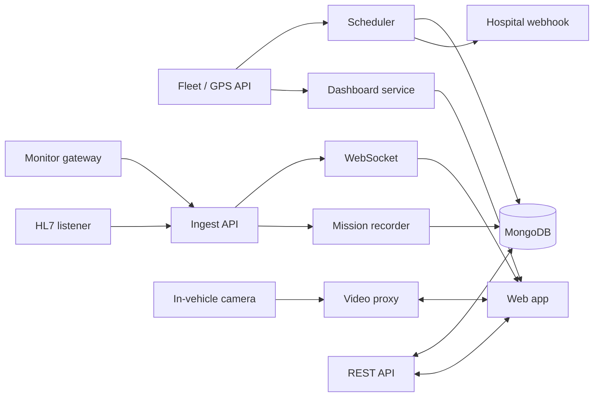
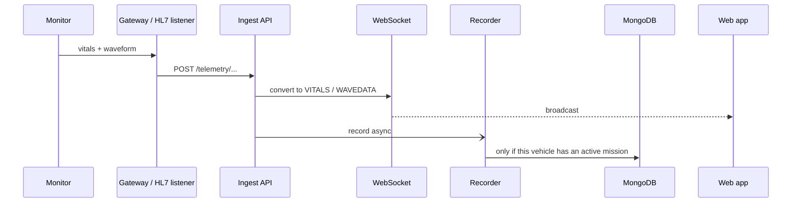
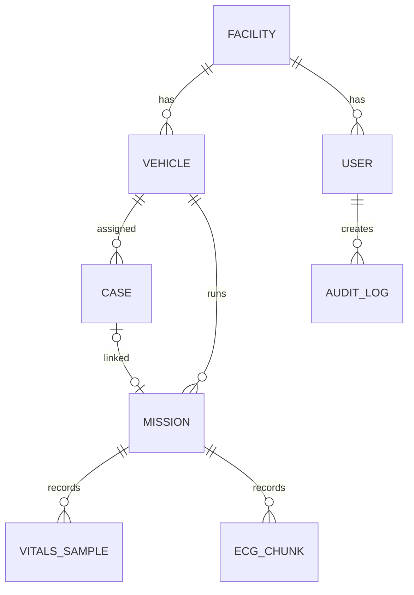

[ไทย](README.md) | [English](README.en.md)

# Connected Ambulance Platform

> **Portfolio & NDA Notice:** This repository contains generalized system architecture, workflow diagrams, and sanitized API/data specifications created strictly for technical portfolio purposes. All proprietary source code, production endpoints, credentials, and client/institution identifiers have been omitted or replaced with generic mock data in strict compliance with Non-Disclosure Agreements (NDA).

A real-time ambulance tracking system. Dispatch centers and receiving hospitals see the vehicle's location, in-vehicle camera and the patient's vital signs on one screen while the patient is on the way.

Stack: Angular, Node.js (Express), MongoDB, WebSocket, node-cron, Nginx, WebRTC/RTSP, HL7 v2

## Role: Systems Analyst

- Gathered requirements from medical staff, dispatch centers and other stakeholders
- Designed the system architecture, data flow, sequences and workflows
- Wrote the specs for the REST API, WebSocket payloads, webhook security and HL7 data mapping
- Designed the database (MongoDB collections and indexes) and data access control (RBAC, audit log)
- Wrote the documentation and set up the security structure needed for ISO/IEC 27001 certification
- Coordinated and tested with the dev team and receiving organizations (SIT / UAT)


## Background

Before this system, every piece of data lived somewhere else. Vehicle location and cameras were on the GPS box vendor's fleet platform, vital signs stayed on the monitor inside the ambulance, and case records were on paper. Doctors at the receiving hospital had no idea of the patient's condition until the ambulance arrived.

The goal was to bring all of it together, with access control so each organization only sees its own vehicles and cases, since this is patient data.

What the system does:

- Map of all vehicles, with status, GPS, speed and alarms refreshed from the fleet platform on a schedule
- Monitor page showing live HR, SpO2, BP, RR and ECG waveforms from the device in the vehicle
- In-vehicle camera view and teleconsult rooms between the hospital and the vehicle
- Dispatch form and EMS operation form
- Start/end an operation (mission); while it runs, vitals and ECG are recorded for playback later
- Dashboard with distance, alarms and overtime parking for a selected date range
- Overspeed alerts and a daily summary pushed to each hospital's system via webhook
- Some features can be turned on or off per hospital, used to pilot features at one site first


## System overview

Data comes in three ways:

1. Vehicle data: a cron job in the backend pulls from the fleet platform API and writes to the DB
2. Vital signs: the gateway attached to the monitor POSTs data to us, and the backend pushes it to the web app over WebSocket
3. Video: goes through a reverse proxy to the vendor's video server



### Vehicle data (pull)

The cron job runs at the interval set in config. Each run logs in to the fleet platform, fetches the vehicle list with online status, coordinates and speed, and upserts it into the DB. Devices not yet linked to a vehicle go to an "unsynced" list for an admin to match by hand.

The same run checks speed. Vehicles over the limit are flagged YELLOW or RED, grouped per hospital and sent to that hospital's webhook. We don't wait for the response, so a slow receiver can't hold up the sync.

Another job runs every hour. It builds yesterday's summary (distance, driving time, number of overspeed events), sends it by webhook and keeps a copy for a while in case it needs to be resent.

Every webhook carries a timestamp and an HMAC-SHA256 signature so the receiver can verify it came from us.

### Vital signs (push)



The gateway sends the monitor's device id with the data. The backend uses it to find the vehicle, maps the value names to one common format, and broadcasts over WebSocket right away.

Some monitor models send HL7 v2 (ORU^R01). A separate listener receives it over MLLP, turns the OBX segments into JSON and posts to the same API. MSH-3 identifies the device.

### Mission (operation recording)

Staff can start an operation from several pages (monitor, map, or when accepting a case). A unique partial index stops a vehicle from having two open missions.

While a mission is active, data going through ingest is also saved. Vitals are sampled at an interval with a NEWS score, and ECG is stored in short chunks with all leads. After the mission ends it can be replayed on the Dashboard.


## Database (Key Entities)



| Entity | Purpose |
| --- | --- |
| Facility | Hospital/organization. Decides who sees which vehicles and cases, and holds feature flags |
| Vehicle | Ambulance, its latest status from the fleet platform, and the id of the monitor on board |
| User | System user, tied to an organization and a role |
| Case | Dispatch case / EMS operation form |
| Mission | One operation by one vehicle (one active at a time) |
| Vitals sample / ECG chunk | Vitals and waveforms recorded during a mission, with limited retention |
| Audit log | Data access history and security events |

Live vitals are not all saved. They are stored only while the vehicle has an open mission.


## Lessons learned

**Don't let DB writes block live data**
Ingest sends to WebSocket first. Mission recording is a separate promise that isn't awaited. If the write fails it just gets logged. The monitor page should never freeze because the DB is slow.

**Plan ECG storage size from day one**
The first version stored a single ECG lead as an array of numbers. Once we needed all leads so playback matched the live monitor, we switched to packing every lead for that time window into one binary buffer instead of one document per lead, with a job that deletes old data after a set retention period.

**Per-IP rate limiting doesn't work for hospitals**
We first limited per IP. But the map page polls often, video also goes through the backend, and many machines in one hospital share a single NAT IP. The whole hospital got blocked. We switched to counting per user from the JWT (falling back to IP without a token). Device push endpoints are kept out of that limit, since devices send often and all come through the same gateway IP.

Login has its own limit, keyed on IP + username, so one person mistyping a password doesn't lock out others on the same IP.

**A dev server with a copy of the production DB must not send webhooks**
Otherwise hospitals get duplicate alerts from the dev machine. An env flag turns them off. There's also a relay that lets the dev server listen to production vitals over WebSocket, read-only, so the monitor page can be tested with real data without a device nearby.

**The dashboard hits the source API hard**
A year of alarm history takes many pages, and the source API limits the time range per call. We fetch in chunks and cache by data type: live status for a short time, vehicle info longer. Past ranges don't change, so they can be cached for a long time.

**Security**
Every request goes through helmet, a CORS allow-list, rate limiting, mongo-sanitize, JWT verification, a role check and a check that the data belongs to the user's organization. Every access to patient data and every denied request goes to the audit log (throttled, so a page left open with an expired token polling over and over doesn't flood the log).

**Preparing for ISO/IEC 27001:** Wrote the system architecture diagram, data flow and information asset register. Set up role-based access control (RBAC) split by organization and user role. Defined the password policy (forced change on first login, hashed passwords). Set the audit log standard (patient data access, data changes and security events kept for 90 days). Defined a code review step before code goes to staging/production.


## Core API

Paths and data below are illustrative mock examples, not the real system's endpoints.

| Method | Path | Purpose |
| --- | --- | --- |
| POST | /api/v1/auth/login | Log in, get a JWT |
| GET | /api/v1/vehicles | Vehicles the user can see, with latest status |
| POST | /api/v1/cases | Create/edit a case |
| POST | /api/v1/missions/start, /end | Start/end an operation |
| POST | /api/v1/telemetry/vitals | Gateway sends vital signs |
| WS | /ws/vitals | Vitals stream to the web app |

Device sends vitals

```json
POST /api/v1/telemetry/vitals
{
  "device_id": "MON-A01",
  "vitals": [
    { "name": "HR", "value": "92" },
    { "name": "SPO2", "value": "96" },
    { "name": "NIBP", "value": "132/84" },
    { "name": "RESP", "value": "18" }
  ]
}
```

HL7 from the monitor, before conversion

```text
MSH|^~\&|MONITOR_X01|AMB-01|CENTRAL|FAC-001|20260101100512||ORU^R01|MSG000123|P|2.6
OBX|1|NM|8867-4^Heart rate^LN||92|/min|||||F
OBX|2|NM|59408-5^SpO2^LN||96|%|||||F
OBX|3|NM|9279-1^Respiratory rate^LN||18|/min|||||F
```

WebSocket message received by the web app

```json
{
  "type": "VITALS",
  "vehicle": "AMB-01",
  "vitals": [{ "name": "HR", "value": "92" }, { "name": "SPO2", "value": "96" }],
  "timestamp": "2026-01-01T03:05:12Z"
}
```

Overspeed alert webhook (sent with a timestamp header and HMAC signature)

```json
{
  "messageType": "ALERT_EVENT",
  "generatedAt": "2026-01-01T03:05:12Z",
  "data": [
    { "vehicle": "AMB-01", "level": "YELLOW", "speedKph": 97.2, "lat": 13.71, "lng": 100.52 }
  ]
}
```
