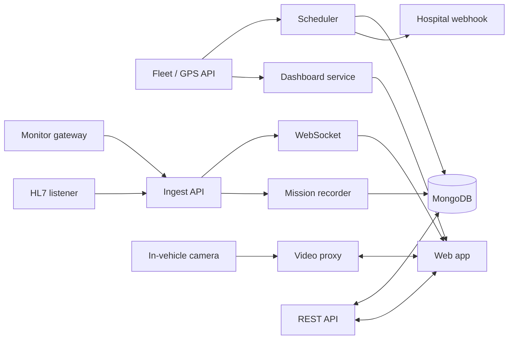
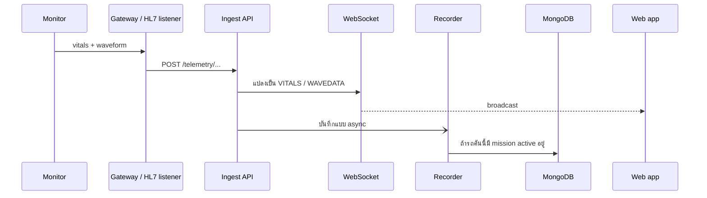
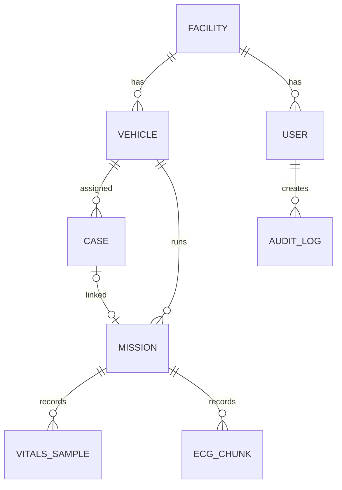

[ไทย](README.md) | [English](README.en.md)

# Connected Ambulance Platform

> **หมายเหตุเรื่องความลับทางการค้า (NDA Notice):** เอกสารใน Repository นี้จัดทำขึ้นเพื่อแสดงแนวคิดการออกแบบสถาปัตยกรรมระบบและ Workflow สำหรับประกอบการสมัครงานเท่านั้น ซอร์สโค้ดจริง Endpoint ของระบบ Production ข้อมูลรับรอง (Credentials) รวมถึงชื่อองค์กรและลูกค้าทั้งหมดถูกตัดออกหรือแทนที่ด้วยข้อมูลสมมติเพื่อปฏิบัติตามข้อตกลงรักษาความลับ (NDA) อย่างเคร่งครัด

ระบบติดตามรถพยาบาลแบบ real-time เอาไว้ให้ศูนย์สั่งการกับโรงพยาบาลปลายทางเห็นตำแหน่งรถ กล้องในรถ และสัญญาณชีพของผู้ป่วยระหว่างนำส่งได้ในหน้าจอเดียว

Stack: Angular, Node.js (Express), MongoDB, WebSocket, node-cron, Nginx, WebRTC/RTSP, HL7 v2

## หน้าที่ที่รับผิดชอบ (Role: Systems Analyst)

- เก็บ Requirement จากทีมแพทย์ ศูนย์สั่งการ และหน่วยงานที่เกี่ยวข้อง
- ออกแบบ System Architecture, Data Flow และลำดับการทำงานของระบบ (Sequence & Workflow)
- กำหนด Spec ของ REST API, WebSocket Payload, Webhook Security และ HL7 Data Mapping
- ออกแบบโครงสร้างฐานข้อมูล (MongoDB Collections & Indexing) และคุมสิทธิ์การเข้าถึงข้อมูล (RBAC / Audit Log)
- จัดทำเอกสารและวางโครงสร้างด้านความปลอดภัยของระบบเพื่อรองรับการขอรับรองมาตรฐาน ISO/IEC 27001
- ประสานงานและทดสอบระบบร่วมกับทีมพัฒนาและหน่วยงานปลายทาง (SIT / UAT)


## ที่มาของโปรเจกต์

ก่อนมีระบบนี้ ข้อมูลแต่ละอย่างอยู่คนละที่ ตำแหน่งรถกับกล้องอยู่บนระบบ fleet ของผู้ผลิตกล่อง GPS สัญญาณชีพอยู่บนเครื่อง monitor ในรถ ส่วนใบบันทึกเคสยังเป็นกระดาษ แพทย์ที่โรงพยาบาลปลายทางเลยไม่รู้อาการผู้ป่วยจนกว่ารถจะมาถึง

โจทย์คือดึงทั้งหมดมารวมกัน และต้องคุมสิทธิ์ให้แต่ละหน่วยงานเห็นเฉพาะรถกับเคสของตัวเอง เพราะเป็นข้อมูลผู้ป่วย

สิ่งที่ระบบทำได้

- แผนที่รถทุกคัน อัปเดตสถานะ, GPS, ความเร็ว และ alarm จากระบบ fleet เป็นรอบ
- หน้า Monitor แสดง HR, SpO2, BP, RR และคลื่น ECG สดจากเครื่องในรถ
- ดูกล้องในรถ และเปิดห้อง teleconsult ระหว่างโรงพยาบาลกับรถ
- ฟอร์มรับแจ้งเหตุและฟอร์มปฏิบัติการ EMS
- กดเริ่ม/จบการปฏิบัติงานได้ ระหว่างนั้นระบบบันทึกสัญญาณชีพกับ ECG ไว้เปิดดูย้อนหลัง (playback)
- Dashboard สรุประยะทาง, alarm และเวลาจอดเกิน ตามช่วงวันที่เลือก
- แจ้งเตือนรถวิ่งเร็วเกินกำหนด และส่งสรุปรายวันไปที่ระบบของโรงพยาบาลผ่าน webhook
- เปิด/ปิดบางฟีเจอร์แยกรายโรงพยาบาลได้ ใช้ตอนทดลองกับบางที่ก่อน


## ภาพรวมระบบ

ข้อมูลเข้ามา 3 ทาง

1. ข้อมูลรถ: backend มี cron ไปดึงจาก API ของระบบ fleet แล้วเขียนลง DB
2. สัญญาณชีพ: ตัว gateway ที่ต่อกับเครื่อง monitor เป็นฝ่าย POST เข้ามาเอง แล้ว backend ส่งต่อให้หน้าเว็บผ่าน WebSocket
3. วิดีโอ: ผ่าน reverse proxy ไปที่ video server ของผู้ผลิต



### ข้อมูลรถ (pull)

cron รันตามรอบที่ตั้งใน config ทุกรอบจะ login ระบบ fleet แล้วดึงรายการรถพร้อมสถานะ online, พิกัด และความเร็ว จากนั้น upsert ลง DB ถ้าเจออุปกรณ์ที่ยังไม่ได้ผูกกับรถในระบบ จะเก็บไว้ในรายการ unsynced ให้ admin มาจับคู่เอง

รอบเดียวกันนี้เช็กความเร็วด้วย ถ้าเกินเกณฑ์จะแบ่งระดับเป็น YELLOW / RED แล้วรวมเป็นก้อนเดียวต่อโรงพยาบาล ส่งไปที่ webhook ของโรงพยาบาลนั้น การส่งไม่รอ response เพราะไม่อยากให้ปลายทางที่ช้ามาถ่วงรอบ sync

อีก job รันทุกชั่วโมง คำนวณสรุปของเมื่อวาน (ระยะทาง, เวลาขับ, จำนวนครั้งที่เร็วเกิน) ส่ง webhook แล้วเก็บสำเนาไว้ช่วงหนึ่งเผื่อต้องส่งซ้ำ

webhook ทุกตัวแนบ timestamp และลายเซ็น HMAC-SHA256 ให้ฝั่งรับเช็กได้ว่ามาจากเราจริง

### สัญญาณชีพ (push)



gateway ส่ง id ของเครื่อง monitor มากับข้อมูล backend ใช้ id นี้หาว่าเป็นรถคันไหน แปลงชื่อค่าต่างๆ ให้เป็นรูปแบบเดียวกัน แล้ว broadcast ออก WebSocket ทันที

เครื่องบางรุ่นส่งเป็น HL7 v2 (ORU^R01) มี listener อีกตัวรับผ่าน MLLP แล้วแปลง OBX ออกมาเป็น JSON ก่อนส่งเข้า API ตัวเดียวกัน ใช้ MSH-3 เป็นตัวระบุเครื่อง

### Mission (บันทึกการปฏิบัติงาน)

เจ้าหน้าที่กดเริ่มปฏิบัติงานได้จากหลายหน้า (หน้า monitor, แผนที่ หรือตอนรับเคส) ระบบใช้ unique partial index กันไม่ให้รถคันเดียวมี mission เปิดซ้อนกัน

ระหว่าง mission active ข้อมูลที่ไหลผ่าน ingest จะถูกเก็บลง DB ด้วย vitals เก็บเป็นระยะพร้อมคะแนน NEWS ส่วน ECG เก็บเป็นก้อนสั้นๆ ทุก lead พอจบ mission จะเปิดดูย้อนหลังได้ในหน้า Dashboard


## Database (Key Entities)



| Entity | หน้าที่ |
| --- | --- |
| Facility | โรงพยาบาล/หน่วยงาน เป็นตัวกำหนดว่าใครเห็นรถและเคสไหน และเก็บค่า feature flag |
| Vehicle | รถพยาบาล สถานะล่าสุดจากระบบ fleet และ id ของเครื่อง monitor ที่ติดรถ |
| User | ผู้ใช้ระบบ ผูกกับหน่วยงานและ role |
| Case | เคสรับแจ้งเหตุ / ฟอร์มปฏิบัติการ |
| Mission | การปฏิบัติงาน 1 ครั้งของรถ 1 คัน (active ได้ทีละ 1) |
| Vitals sample / ECG chunk | สัญญาณชีพและคลื่นที่บันทึกระหว่าง mission มีอายุจำกัด |
| Audit log | ประวัติการเข้าถึงข้อมูลและเหตุการณ์ด้านความปลอดภัย |

สัญญาณชีพสดไม่ได้ลง DB ทุกค่า จะเก็บเฉพาะตอนที่รถมี mission เปิดอยู่


## เรื่องที่ได้เรียนรู้ระหว่างทำ

**อย่าให้การเขียน DB มาขวางข้อมูลสด**
ingest ส่ง WebSocket ออกไปก่อน ส่วนการบันทึก mission แยกเป็น promise ที่ไม่ await ถ้าเขียนพังก็แค่ log ไว้ หน้า monitor ไม่ควรค้างเพราะ DB ช้า

**ECG ต้องคิดเรื่องขนาดตั้งแต่แรก**
เวอร์ชันแรกเก็บ ECG ได้ lead เดียว เป็น array ของตัวเลข พอต้องเก็บทุก lead เพื่อให้ playback เหมือนหน้า monitor จริง เลยเปลี่ยนเป็นรวมทุก lead ของช่วงนั้นไว้ใน binary buffer เดียวแทนการแยกเอกสารต่อ lead แล้วมี job ลบข้อมูลเก่าทิ้งตามอายุที่กำหนด

**Rate limit แบบนับต่อ IP ใช้ไม่ได้กับโรงพยาบาล**
แรกๆ จำกัดต่อ IP แต่หน้าแผนที่ poll ถี่ บวกวิดีโอที่วิ่งผ่าน backend ด้วย และหลายเครื่องในโรงพยาบาลเดียวกันออกเน็ตผ่าน NAT IP เดียว ผลคือโดนบล็อกทั้งโรงพยาบาล เลยเปลี่ยนไปนับต่อ user จาก JWT (ถ้าไม่มี token ค่อยใช้ IP) ส่วน endpoint ที่เครื่อง monitor ส่งข้อมูลเข้ามาแยกออกจาก limit นี้ เพราะเครื่องส่งถี่และมาจาก gateway IP เดียวกัน

login แยก limit ต่างหาก นับเป็นคู่ IP + username คนพิมพ์รหัสผิดจะได้ไม่ทำให้คนอื่นที่ใช้ IP เดียวกันโดนล็อกไปด้วย

**dev ที่ใช้ DB ก๊อปจาก production อย่าส่ง webhook**
ไม่งั้นโรงพยาบาลจะได้แจ้งเตือนซ้ำจากเครื่อง dev เลยมี env flag ปิดไว้ และมีตัว relay ให้เครื่อง dev ต่อ WebSocket ไปฟังสัญญาณชีพจาก production แบบอ่านอย่างเดียว เอาไว้ทดสอบหน้า monitor กับข้อมูลจริงได้โดยไม่ต้องมีเครื่องอยู่ใกล้ๆ

**Dashboard ยิง API ต้นทางหนักมาก**
ข้อมูล alarm ย้อนหลังเป็นปีต้องดึงหลายหน้า และ API ต้นทางจำกัดช่วงเวลาต่อครั้ง เลยแบ่งดึงเป็นช่วงๆ แล้ว cache แยกตามประเภทข้อมูล สถานะสดเก็บสั้น ข้อมูลรถเก็บนานขึ้น ช่วงเวลาที่ผ่านไปแล้วข้อมูลไม่เปลี่ยน cache ได้นาน

**Security**
ทุก request ผ่าน helmet, CORS แบบ allow-list, rate limit, mongo-sanitize, ตรวจ JWT, เช็ก role และเช็กว่าเป็นข้อมูลของหน่วยงานตัวเอง การเข้าดูข้อมูลผู้ป่วยและการโดนปฏิเสธสิทธิ์ทุกครั้งลง audit log (มี throttle กัน log ท่วมเวลามีหน้าเว็บค้าง token หมดอายุแล้ว poll ซ้ำ)

**การเตรียมระบบตามมาตรฐาน ISO/IEC 27001:** จัดทำเอกสาร System Architecture Diagram, Data Flow และทะเบียนทรัพย์สินสารสนเทศ (Information Asset Register) ของระบบ วางโครงสร้างการคุมสิทธิ์แบบ Role-Based Access Control (RBAC) แยกตามหน่วยงานและบทบาทผู้ใช้งาน กำหนดนโยบายรหัสผ่าน (บังคับเปลี่ยนรหัสผ่านครั้งแรก, การเข้ารหัส Password Hash) รวมถึงวางมาตรฐานการบันทึก Audit Log (เก็บประวัติการเข้าถึงข้อมูลผู้ป่วย การแก้ไขข้อมูล และเหตุการณ์ด้านความปลอดภัยย้อนหลัง 90 วัน) และกำหนดขั้นตอน Code Review ก่อนนำโค้ดขึ้น Staging/Production


## Deployment, Infrastructure & Security

ระบบรันบน Windows Server ที่เป็น VM บน enterprise cloud เครื่องเดียวรองรับทั้ง production, ชุดที่ตัดขอบเขตไว้สำหรับรับรอง ISO และ dev โดยแยกกันด้วย virtual host ของ Nginx

**Network & Firewall**
- เปิดจากภายนอกแค่ HTTP กับ HTTPS พอร์ต HTTP มีไว้ redirect ไป HTTPS และให้ ACME ยืนยันโดเมนตอนออกใบรับรองเท่านั้น
- REST, WebSocket และการเรียก video server วิ่งผ่าน 443 ทั้งหมด ตัว backend กับ media service ฟังแค่ localhost ไม่เปิดออกนอกเครื่อง

**Reverse Proxy & SSL/TLS**
- Nginx เป็นทางเข้าทางเดียว ส่ง `/api` ไป backend และ upgrade connection ให้ WebSocket
- ใบรับรองต่ออายุอัตโนมัติผ่าน ACME client หลังต่ออายุจะรัน script ที่สั่ง `nginx -t` ก่อน ถ้า config ผิดจะไม่ reload ระบบที่รันอยู่ไม่สะดุด
- เปิดเฉพาะ TLS 1.2 / 1.3 มี HSTS และ security header (nosniff, frame options, referrer policy) ส่วน dev ใส่ noindex กันถูก index
- ถ้ามีคนตั้งค่าให้ข้ามการตรวจ certificate ของการเชื่อมต่อขาออกบน production ตัว backend จะไม่ยอม start

**Source Control (GitLab)**
- `main` คือ production ทุก release ติด tag เวอร์ชัน, `dev` ใช้ขึ้น staging, งานใหม่แตกเป็น `feature/*` หรือ `fix/*` และขึ้น production ผ่าน `release/*` หรือ `hotfix/*`
- ห้าม push ตรงเข้า `main` กับ `dev` ต้องผ่าน Merge Request เท่านั้น
- MR ต้องมีคนที่ไม่ใช่ผู้เขียน approve อย่างน้อย 1 คน งานที่แตะ security, สิทธิ์ หรือข้อมูลผู้ป่วย ต้องให้ tech lead approve เพิ่ม แล้ว merge แบบ squash
- เครื่อง dev มี git hook กัน commit ไฟล์ `.env` สแกนหา secret ก่อน commit และบังคับรูปแบบ commit message (Conventional Commits)

**CI/CD**
- GitLab pipeline รันทุก MR และทุกครั้งที่มีอะไรเข้า `main`, `dev` หรือติด tag มีขั้นตรวจชื่อ MR, secret detection และ dependency audit ของทั้ง frontend และ backend ถ้าเจอช่องโหว่ระดับ critical จะไม่ผ่าน
- ผลสแกนเก็บเป็น artifact 1 ปี ไว้ใช้เป็นหลักฐานการจัดการช่องโหว่ตอน audit
- การ deploy ยังทำตามขั้นตอนที่เขียนไว้แบบ manual มี PowerShell script ช่วยงานที่ทำซ้ำ เช่น reload config และ rotate log

**Server Hardening (ISO/IEC 27001)**
- ปิด service และพอร์ตที่ไม่ได้ใช้ remote access เข้าเครื่องได้เฉพาะผู้ดูแลที่ได้รับสิทธิ์
- secret อยู่ใน environment ของเครื่อง ไม่อยู่ใน repo ใน repo มีแค่ไฟล์ตัวอย่าง
- log ของ Nginx rotate ทุกวันด้วย Scheduled Task บีบอัดแล้วเก็บ 90 วันเป็นหลักฐาน และรันด้วย priority ต่ำ ไม่ให้แย่งทรัพยากร production
- audit log ของแอปเก็บ 90 วัน และ backup ฐานข้อมูลอัตโนมัติทุกวัน ตั้งเป้า RPO 24 ชม. / RTO 4 ชม.
- ชุดที่ใช้ขอรับรองเป็น build แยก ฟีเจอร์ที่อยู่นอกขอบเขตไม่ถูกเปิดเลย (เรียกแล้วได้ 404) ขอบเขตที่ auditor ตรวจจึงชัดเจน


## Core API

path และข้อมูลด้านล่างเป็นตัวอย่างสมมติ ไม่ใช่ endpoint จริงของระบบ

| Method | Path | ใช้ทำอะไร |
| --- | --- | --- |
| POST | /api/v1/auth/login | login ได้ JWT |
| GET | /api/v1/vehicles | รถที่ผู้ใช้มีสิทธิ์เห็น พร้อมสถานะล่าสุด |
| POST | /api/v1/cases | สร้าง/แก้เคส |
| POST | /api/v1/missions/start, /end | เริ่ม/จบการปฏิบัติงาน |
| POST | /api/v1/telemetry/vitals | gateway ส่งสัญญาณชีพเข้าระบบ |
| WS | /ws/vitals | stream สัญญาณชีพให้หน้าเว็บ |

เครื่องส่งสัญญาณชีพเข้ามา

```json
POST /api/v1/telemetry/vitals
{
  "device_id": "MON-A01",
  "vitals": [
    { "name": "HR", "value": "92" },
    { "name": "SPO2", "value": "96" },
    { "name": "NIBP", "value": "132/84" },
    { "name": "RESP", "value": "18" }
  ]
}
```

HL7 จากเครื่อง monitor ก่อนแปลง

```text
MSH|^~\&|MONITOR_X01|AMB-01|CENTRAL|FAC-001|20260101100512||ORU^R01|MSG000123|P|2.6
OBX|1|NM|8867-4^Heart rate^LN||92|/min|||||F
OBX|2|NM|59408-5^SpO2^LN||96|%|||||F
OBX|3|NM|9279-1^Respiratory rate^LN||18|/min|||||F
```

ข้อความที่หน้าเว็บได้จาก WebSocket

```json
{
  "type": "VITALS",
  "vehicle": "AMB-01",
  "vitals": [{ "name": "HR", "value": "92" }, { "name": "SPO2", "value": "96" }],
  "timestamp": "2026-01-01T03:05:12Z"
}
```

Webhook แจ้งเตือนความเร็ว (แนบ header timestamp + HMAC signature)

```json
{
  "messageType": "ALERT_EVENT",
  "generatedAt": "2026-01-01T03:05:12Z",
  "data": [
    { "vehicle": "AMB-01", "level": "YELLOW", "speedKph": 97.2, "lat": 13.71, "lng": 100.52 }
  ]
}
```
