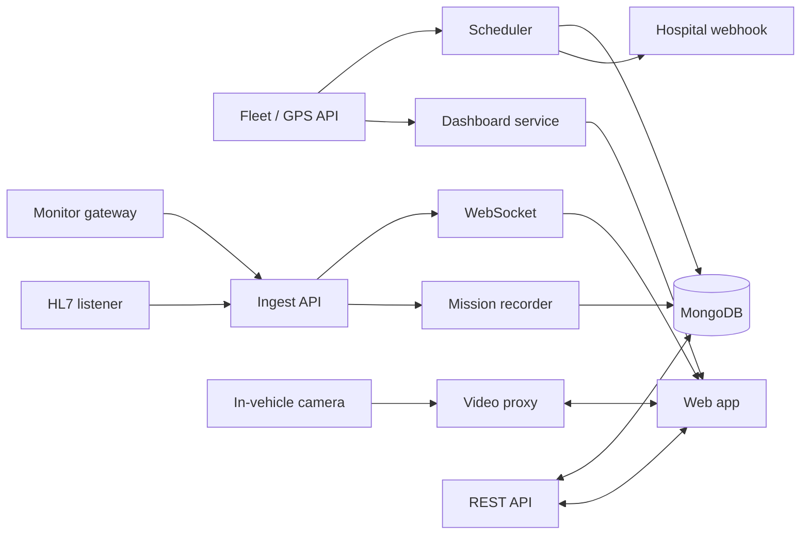
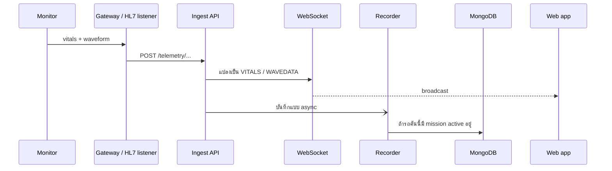
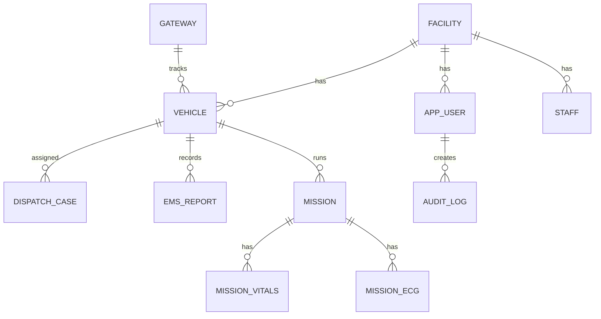

[ไทย](README.md) | [English](README.en.md)

# Connected Ambulance Platform

ระบบติดตามรถพยาบาลแบบ real-time เอาไว้ให้ศูนย์สั่งการกับโรงพยาบาลปลายทางเห็นตำแหน่งรถ กล้องในรถ และสัญญาณชีพของผู้ป่วยระหว่างนำส่งได้ในหน้าจอเดียว

repo นี้เป็นสรุปการออกแบบระบบเพื่อใช้เป็น portfolio ไม่มี source code จริง ชื่อตาราง, endpoint และข้อมูลตัวอย่างเปลี่ยนเป็นชื่อกลางทั้งหมด ไม่เกี่ยวกับข้อมูลจริงของลูกค้า

Stack: Angular, Node.js (Express), MongoDB, WebSocket, node-cron, Nginx, WebRTC/RTSP, HL7 v2

## หน้าที่ที่รับผิดชอบ (Role: Systems Analyst)

- เก็บ Requirement จากทีมแพทย์ ศูนย์สั่งการ และหน่วยงานที่เกี่ยวข้อง
- ออกแบบ System Architecture, Data Flow และลำดับการทำงานของระบบ (Sequence & Workflow)
- กำหนด Spec ของ REST API, WebSocket Payload, Webhook Security และ HL7 Data Mapping
- ออกแบบโครงสร้างฐานข้อมูล (MongoDB Collections & Indexing) และคุมสิทธิ์การเข้าถึงข้อมูล (RBAC / Audit Log)
- จัดทำเอกสารและวางโครงสร้างด้านความปลอดภัยของระบบเพื่อรองรับการขอรับรองมาตรฐาน ISO/IEC 27001
- ประสานงานและทดสอบระบบร่วมกับทีมพัฒนาและหน่วยงานปลายทาง (SIT / UAT)


## ที่มาของโปรเจกต์

ก่อนมีระบบนี้ ข้อมูลแต่ละอย่างอยู่คนละที่ ตำแหน่งรถกับกล้องอยู่บนระบบ fleet ของผู้ผลิตกล่อง GPS สัญญาณชีพอยู่บนเครื่อง monitor ในรถ ส่วนใบบันทึกเคสยังเป็นกระดาษ แพทย์ที่โรงพยาบาลปลายทางเลยไม่รู้อาการผู้ป่วยจนกว่ารถจะมาถึง

โจทย์คือดึงทั้งหมดมารวมกัน และต้องคุมสิทธิ์ให้แต่ละหน่วยงานเห็นเฉพาะรถกับเคสของตัวเอง เพราะเป็นข้อมูลผู้ป่วย

สิ่งที่ระบบทำได้ตอนนี้

- แผนที่รถทุกคัน อัปเดตสถานะ, GPS, ความเร็ว และ alarm จากระบบ fleet เป็นรอบ
- หน้า Monitor แสดง HR, SpO2, BP, RR และคลื่น ECG สดจากเครื่องในรถ
- ดูกล้องในรถ และเปิดห้อง teleconsult ระหว่างโรงพยาบาลกับรถ
- ฟอร์มรับแจ้งเหตุและฟอร์มปฏิบัติการ EMS
- กดเริ่ม/จบการปฏิบัติงานได้ ระหว่างนั้นระบบบันทึกสัญญาณชีพกับ ECG ไว้เปิดดูย้อนหลัง (playback)
- Dashboard สรุประยะทาง, alarm, เวลาจอดเกิน ตามช่วงวันที่เลือก
- แจ้งเตือนรถวิ่งเร็วเกินกำหนด และส่งสรุปรายวันไปที่ระบบของโรงพยาบาลผ่าน webhook
- เปิด/ปิดบางฟีเจอร์แยกรายโรงพยาบาลได้ ใช้ตอนทดลองกับบางที่ก่อน


## ภาพรวมระบบ

ข้อมูลเข้ามา 3 ทาง

1. ข้อมูลรถ: backend มี cron ไปดึงจาก API ของระบบ fleet แล้วเขียนลง DB
2. สัญญาณชีพ: ตัว gateway ที่ต่อกับเครื่อง monitor เป็นฝ่าย POST เข้ามาเอง แล้ว backend ส่งต่อให้หน้าเว็บผ่าน WebSocket
3. วิดีโอ: ผ่าน reverse proxy ไปที่ video server ของผู้ผลิต



### ข้อมูลรถ (pull)

cron รันตามรอบที่ตั้งใน config ทุกรอบจะ login ระบบ fleet แล้วดึงรายการรถพร้อมสถานะ online, พิกัด และความเร็ว จากนั้น upsert ลง collection `vehicle` ถ้าเจออุปกรณ์ที่ยังไม่ได้ผูกกับรถในระบบ จะเก็บไว้ในรายการ unsynced ให้ admin มาจับคู่เอง

รอบเดียวกันนี้เช็กความเร็วด้วย เกิน 90 km/h เป็น YELLOW เกิน 120 เป็น RED แล้วรวมเป็นก้อนเดียวต่อโรงพยาบาล ส่งไปที่ webhook ของโรงพยาบาลนั้น การส่งไม่รอ response (timeout 5 วินาที) เพราะไม่อยากให้ปลายทางที่ช้ามาถ่วงรอบ sync

อีก job รันทุกชั่วโมง คำนวณสรุปของเมื่อวาน (ระยะทาง, เวลาขับ, จำนวนครั้งที่เร็วเกิน) ส่ง webhook แล้วเก็บสำเนาไว้ 7 วัน เผื่อต้องส่งซ้ำ

webhook ทุกตัวแนบ `x-timestamp` และ `x-signature` (HMAC-SHA256 ของ timestamp + body) ให้ฝั่งรับเช็กได้ว่ามาจากเราจริง

### สัญญาณชีพ (push)



gateway ส่ง `monitor_id` มากับข้อมูล backend ใช้ id นี้หาว่าเป็นรถคันไหน แปลงชื่อค่าต่างๆ ให้เป็นรูปแบบเดียวกัน แล้ว broadcast ออก WebSocket ทันที

เครื่องบางรุ่นส่งเป็น HL7 v2 (ORU^R01) มี listener อีกตัวรับผ่าน MLLP แล้วแปลง OBX ออกมาเป็น JSON ก่อนส่งเข้า API ตัวเดียวกัน ใช้ MSH-3 เป็นตัวระบุเครื่อง

### Mission (บันทึกการปฏิบัติงาน)

เจ้าหน้าที่กดเริ่มปฏิบัติงานได้จากหลายหน้า (หน้า monitor, แผนที่ หรือตอนรับเคส) ระบบใช้ unique partial index บน `vehicle` + `status: active` กันไม่ให้รถคันเดียวมี mission เปิดซ้อนกัน

ระหว่าง mission active ข้อมูลที่ไหลผ่าน ingest จะถูกเก็บลง DB ด้วย

- vitals เก็บไม่เกิน 1 จุดต่อ 5 วินาทีต่อคัน พร้อมคะแนน NEWS
- ECG เก็บเป็นก้อนละประมาณ 1 วินาที ทุก lead

พอจบ mission จะเปิดดูย้อนหลังได้ในหน้า Dashboard กราฟ vitals ทั้งเคส และ ECG ทีละช่วง (ขอได้ครั้งละไม่เกิน 60 วินาที)


## Database



| Collection | ฟิลด์สำคัญ | หมายเหตุ |
| --- | --- | --- |
| facility | facility_code, name, lat, lng, webhook_url, webhook_enabled, dashboard_enabled, mission_enabled | ตัวกลางของสิทธิ์และ feature flag |
| vehicle | display_name, device_id, monitor_id, hl7_source_id, online, speed_kph, position, alarms, gateway_id | monitor_id / hl7_source_id ใช้จับคู่เครื่อง monitor กับรถ |
| gateway | name, api_base_url, session_token | ระบบ fleet ต้นทาง |
| app_user | username, password_hash, role, facility_code, must_change_password | รหัสที่ admin ตั้งให้ต้องเปลี่ยนก่อนใช้งาน |
| staff | staff_code, name, facility_code | |
| dispatch_case | case_no, vehicle_id, location, symptoms, triage_level, timeline, crew, patients | ฟอร์มรับแจ้ง |
| ems_report | operation_no, officers, timeline, patient, treatment | ฟอร์มปฏิบัติการ |
| mission | vehicle, status, start, end, case_id, patient snapshot | active ได้ทีละ 1 ต่อคัน |
| mission_vitals | mission_id, t, hr, pr, spo2, rr, sys, dia, map, news | |
| mission_ecg | mission_id, t, leads, n, data (binary) | ลบอัตโนมัติหลัง 24 ชม. |
| consult_session | room_id, caller, participants, start, end | |
| audit_log | user, action, resource, ip, status, timestamp | TTL 90 วัน |
| daily_summary_outbox | facility_id, summary_date, vehicles | TTL 7 วัน |

สัญญาณชีพสดไม่ได้ลง DB ทุกค่า จะเก็บเฉพาะตอนที่รถมี mission เปิดอยู่


## เรื่องที่ได้เรียนรู้ระหว่างทำ

**อย่าให้การเขียน DB มาขวางข้อมูลสด**
ingest ส่ง WebSocket ออกไปก่อน ส่วนการบันทึก mission แยกเป็น promise ที่ไม่ await ถ้าเขียนพังก็แค่ log ไว้ หน้า monitor ไม่ควรค้างเพราะ DB ช้า

**ECG ต้องคิดเรื่องขนาดตั้งแต่แรก**
เวอร์ชันแรกเก็บ ECG ได้ lead เดียว เป็น array ของตัวเลข พอต้องเก็บทุก lead เพื่อให้ playback เหมือนหน้า monitor จริง เลยเปลี่ยนเป็นรวมทุก lead ของช่วงนั้นไว้ใน Buffer เดียว (Int16LE เรียงทีละ lead) แทนการแยกเอกสารต่อ lead แล้วมี cron ลบของที่เก่ากว่า 24 ชม. ทุกเที่ยงคืน ตัวอ่านยังรองรับรูปแบบเก่าจนข้อมูลชุดนั้นหมดอายุไป

**Rate limit แบบนับต่อ IP ใช้ไม่ได้กับโรงพยาบาล**
แรกๆ จำกัดต่อ IP แต่หน้าแผนที่ poll ทุก 2-5 วินาที บวกวิดีโอที่วิ่งผ่าน backend ด้วย และหลายเครื่องในโรงพยาบาลเดียวกันออกเน็ตผ่าน NAT IP เดียว ผลคือโดนบล็อกทั้งโรงพยาบาล เลยเปลี่ยนไปนับต่อ user id จาก JWT (ถ้าไม่มี token ค่อยใช้ IP) ส่วน endpoint ที่เครื่อง monitor ส่งข้อมูลเข้ามาไม่นับเลย เพราะเครื่องหนึ่งส่งราว 150 ครั้งต่อนาที และทุกเครื่องผ่าน gateway IP เดียวกัน

login แยก limit ต่างหาก 5 ครั้งต่อ 15 นาที นับเป็นคู่ IP + username คนพิมพ์รหัสผิดจะได้ไม่ทำให้คนอื่นที่ใช้ IP เดียวกันโดนล็อกไปด้วย

**dev ที่ใช้ DB ก๊อปจาก production อย่าส่ง webhook**
ไม่งั้นโรงพยาบาลจะได้แจ้งเตือนซ้ำจากเครื่อง dev เลยมี env `WEBHOOKS_ENABLED` ปิดไว้ และมีตัว relay ให้เครื่อง dev ต่อ WebSocket ไปฟังสัญญาณชีพจาก production แบบอ่านอย่างเดียว เอาไว้ทดสอบหน้า monitor กับข้อมูลจริงได้โดยไม่ต้องมีเครื่องอยู่ใกล้ๆ

**Dashboard ยิง API ต้นทางหนักมาก**
ข้อมูล alarm ย้อนหลังเป็นปีต้องดึงหลายหน้า และ API ต้นทางรับช่วงเวลาได้ไม่เกินประมาณ 90 วันต่อครั้ง เลยแบ่งดึงทีละ 85 วัน แล้ว cache แยกตามประเภทข้อมูล สถานะสดเก็บ 30 วินาที ข้อมูลรถเก็บ 30 นาที alarm ของช่วงที่รวมวันนี้เก็บ 5 นาที ช่วงที่ผ่านไปแล้วข้อมูลไม่เปลี่ยน cache ได้นาน

**Security**
ทุก request ผ่าน helmet, CORS แบบ allow-list, rate limit, mongo-sanitize, ตรวจ JWT, เช็ก role และเช็กว่าเป็นข้อมูลของหน่วยงานตัวเอง การเข้าดูข้อมูลผู้ป่วยและการโดนปฏิเสธสิทธิ์ทุกครั้งลง audit log (มี throttle กัน log ท่วมเวลามีหน้าเว็บค้าง token หมดอายุแล้ว poll ซ้ำ)

**การเตรียมระบบตามมาตรฐาน ISO/IEC 27001:** จัดทำเอกสาร System Architecture Diagram, Data Flow และทะเบียนทรัพย์สินสารสนเทศ (Information Asset Register) ของระบบ วางโครงสร้างการคุมสิทธิ์แบบ Role-Based Access Control (RBAC) แยกตามหน่วยงานและบทบาทผู้ใช้งาน กำหนดนโยบายรหัสผ่าน (บังคับเปลี่ยนรหัสผ่านครั้งแรก, การเข้ารหัส Password Hash) รวมถึงวางมาตรฐานการบันทึก Audit Log (เก็บประวัติการเข้าถึงข้อมูลผู้ป่วย การแก้ไขข้อมูล และเหตุการณ์ด้านความปลอดภัยย้อนหลัง 90 วัน) และกำหนดขั้นตอน Code Review ก่อนนำโค้ดขึ้น Staging/Production


## API

ต้องแนบ `Authorization: Bearer <token>` ทุกตัว ยกเว้น login, health และ endpoint ที่เครื่องส่งข้อมูลเข้ามา

| Method | Path | ใช้ทำอะไร |
| --- | --- | --- |
| POST | /api/v1/auth/login | login ได้ JWT |
| POST | /api/v1/users/change-password | เปลี่ยนรหัสผ่าน |
| GET | /api/v1/vehicles | รถทั้งหมดที่มีสิทธิ์เห็น |
| POST | /api/v1/vehicles/:id/alarms/clear | เคลียร์ alarm |
| POST | /api/v1/facilities | เพิ่ม/แก้โรงพยาบาล (admin) |
| GET | /api/v1/facilities/:code/cases?date= | เคสของวันนั้น |
| GET | /api/v1/cases/:id | ดูเคส |
| POST | /api/v1/cases | สร้าง/แก้เคส |
| POST | /api/v1/ems-reports | บันทึกฟอร์ม EMS |
| GET | /api/v1/missions/status | สถานะการปฏิบัติงานของรถแต่ละคัน |
| POST | /api/v1/missions/start | เริ่มปฏิบัติงาน |
| POST | /api/v1/missions/end | จบปฏิบัติงาน |
| GET | /api/v1/missions?from=&to= | ประวัติ |
| GET | /api/v1/missions/:id | รายละเอียด + vitals |
| GET | /api/v1/missions/:id/ecg?from=&sec= | ECG ช่วงที่เลือก |
| GET | /api/v1/dashboard/vehicles?from=&to= | ข้อมูลหน้า dashboard |
| POST | /api/v1/telemetry/vitals | เครื่องส่ง vitals |
| POST | /api/v1/telemetry/waveforms | เครื่องส่งคลื่น |
| POST | /api/v1/telemetry/hl7-vitals | ข้อมูลจาก HL7 listener |
| WS | /ws/vitals | stream ให้หน้าเว็บ |
| GET | /health | health check |

ข้อมูลข้างล่างเป็นข้อมูลสมมติทั้งหมด

Login

```json
POST /api/v1/auth/login
{ "username": "dispatcher01", "password": "********" }

{
  "token": "eyJhbGciOiJIUzI1NiIsInR5cCI6IkpXVCJ9...",
  "user": { "id": "u_1001", "role": "operator", "facility_code": "FAC-001", "must_change_password": false }
}
```

รายการรถ

```json
GET /api/v1/vehicles
[
  {
    "id": "veh_01",
    "display_name": "AMB-01",
    "monitor_id": "MON-A01",
    "online": 1,
    "speed_kph": 64.5,
    "position": { "lat": 13.70, "lng": 100.50 },
    "alarms": []
  }
]
```

สร้างเคส

```json
POST /api/v1/cases
{
  "case_no": "FAC001-20261112-0007",
  "vehicle_id": "veh_01",
  "location": { "address": "123 Sample Rd.", "lat": 13.7012, "lng": 100.5034 },
  "symptoms": ["chest_pain"],
  "triage_level": "RED",
  "timeline": { "reported": "10:02", "assigned": "10:03", "departed": "10:05" },
  "patients": [{ "initials": "J.D.", "age": 58, "gender": "M" }]
}
```

เริ่มปฏิบัติงาน

```json
POST /api/v1/missions/start
{ "vehicle": "AMB-01", "source": "monitor", "case_id": "case_7f3a" }

{ "id": "mis_5501", "vehicle": "AMB-01", "status": "active", "start": "2026-11-12T03:05:00Z" }
```

เครื่องส่ง vitals / waveform

```json
POST /api/v1/telemetry/vitals
{
  "monitor_id": "MON-A01",
  "vitals": [
    { "name": "HR", "value": "92" },
    { "name": "SPO2", "value": "96" },
    { "name": "Sys", "value": "132" },
    { "name": "Dia", "value": "84" },
    { "name": "RESP", "value": "18" }
  ]
}

{ "success": true, "vehicle": "AMB-01", "broadcast_to": 3 }
```

```json
POST /api/v1/telemetry/waveforms
{
  "monitor_id": "MON-A01",
  "waves": { "ECG_II": [2048, 2051, 2060, 2110, 2300, 2120, 2050] }
}
```

HL7 จากเครื่อง monitor (ก่อนแปลง)

```text
MSH|^~\&|MONITOR_X01|AMB-01|CENTRAL|FAC-001|20261112100512||ORU^R01|MSG000123|P|2.6
PID|1||PAT0001||DOE^JOHN||19680101|M
OBR|1|||VITALS|||20261112100512
OBX|1|NM|8867-4^Heart rate^LN||92|/min|||||F
OBX|2|NM|59408-5^SpO2^LN||96|%|||||F
OBX|3|NM|8480-6^Systolic BP^LN||132|mm[Hg]|||||F
OBX|4|NM|8462-4^Diastolic BP^LN||84|mm[Hg]|||||F
OBX|5|NM|9279-1^Respiratory rate^LN||18|/min|||||F
```

หลัง listener แปลงแล้วส่งเข้า API

```json
POST /api/v1/telemetry/hl7-vitals
{
  "hl7_source_id": "MONITOR_X01",
  "vitals": { "HR": 92, "PR": 91, "SPO2": 96, "RESP": 18, "SYS": 132, "DIA": 84, "MEAN": 100 }
}
```

ข้อความที่หน้าเว็บได้จาก WebSocket

```json
{
  "type": "VITALS",
  "vehicle": "AMB-01",
  "vitals": [{ "name": "HR", "value": "92" }, { "name": "SPO2", "value": "96" }],
  "timestamp": "2026-11-12T03:05:12Z"
}
```

Webhook แจ้งเตือนความเร็ว

```json
{
  "messageId": "msg_alert_1762916712",
  "messageType": "ALERT_EVENT",
  "generatedAt": "2026-11-12T03:05:12Z",
  "data": [
    { "vehicleId": "DEV-0001", "name": "AMB-01", "level": "YELLOW", "speedKph": 97.2, "speedLimitKph": 90, "lat": 13.71, "lng": 100.52 }
  ]
}
```

Webhook สรุปรายวัน

```json
{
  "messageType": "DAILY_SUMMARY",
  "summaryDate": "2026-11-11",
  "vehicles": [
    { "vehicleId": "DEV-0001", "name": "AMB-01", "distanceKm": 142.6, "driveMinutes": 315, "overLimitCount": 3, "maxSpeedKph": 118.4 }
  ]
}
```
